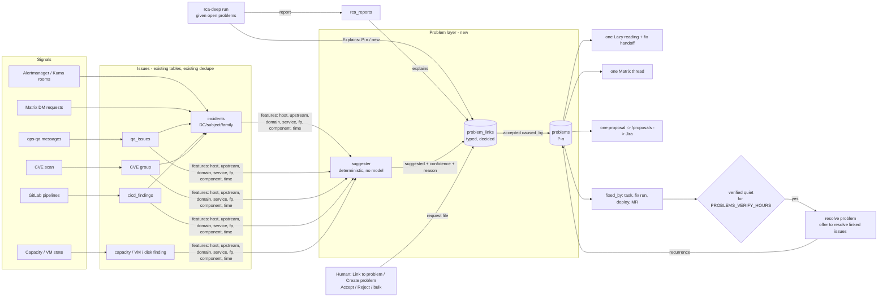
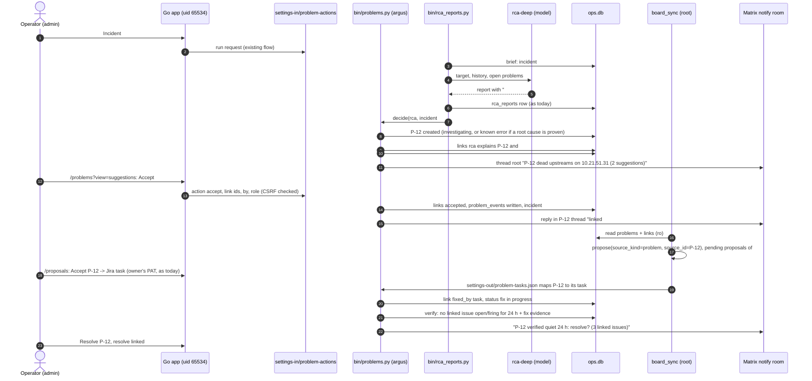

# HLD: Problem records — relating incidents, QA issues, CVE groups and CI findings to one root cause

Status: proposal, 2026-10-22. Author: Sam (architecture). Baseline: `main` at `99c759d` (Go app live on argus-01
since 2026-10-22, Python app frozen as the rollback image). Decision record: [ADR-0008](adr/0008-problem-records.md).
Companions: [OVERVIEW.md](OVERVIEW.md), [CONFIG.md](CONFIG.md) §3.12, [ACCESS.md](ACCESS.md), [ROADMAP.md](ROADMAP.md)
phase D.

The operator's request: *"For the incidents, QA reports and things like that, create a flow so I can relate the issues.
One RCA contains multiple issues; I can map the issues to this one."*

## 1. The gap, in today's code

| object | table (writer) | key / grouping today | links out today |
|---|---|---|---|
| alert, Kuma, QA message | `chat_messages` (ops-watch, chat-triage), `alerts`, `queue/*.json` | ops-watch fingerprint, Matrix event id | `chat_messages.incident_id`, `.issue_id` |
| incident | `incidents` + `incident_events` (`bin/incidents.py`) | `DC\|subject\|family`, one per subject × symptom family | — |
| QA issue | `qa_issues` (`bin/qa_issues.py`) | one per reported problem, groups messages | `qa_issues.incident_id` (one) |
| CVE finding / group | `cve_findings` (`bin/cve_feeds/store.py`, `cve_match.py`) | `dkey`, `group_key` | `cve_findings.incident_id` (one, `CVE\|<group>\|cve`) |
| CI/CD finding | `cicd_findings` (`bin/cicd_db.py`) | `key` | `cicd_findings.incident_id` (one, `CICD\|<path>@<ref>\|ci-*`) |
| capacity / VM / disk finding | `capacity.json`, `vm_reports`, `disk_reports` | VM, mount | none |
| quick finding ("problem" of a run) | `triage_problems` (`bin/record.py`) | `(run_id, idx)` | via `incident_events.run_id/idx` |
| RCA report | `rca_reports` (`bin/rca_reports.py`) | `path` | `rca_reports.incident_id` (one) |
| fix handoff, Lazy reading | columns on `rca_reports`, `triage_problems`, `incidents` (`bin/fix_store.py`) | `fix_ref` `rca:<id>` beats `problem:<run>:<idx>` | per incident |
| proposed task → Jira | `proposals`, `tasks` in board.db (root, `bin/proposals.py`, `board_sync.py`) | `(source_kind, source_id)` | one source each |
| fix run | `fix_runs` (`bin/fix-record.py`) | request id | `problem_run`, `problem_idx` |

Every arrow is **one-to-one or many-to-one into a single incident**, and the incident key is a symptom key. A root
cause that produces symptoms on several subjects (incident #2: dead upstreams on `10.21.51.31` explain the
`www`/`admin.cdn.northwind.example` 5xx incidents, the QA reports about admin.cdn.northwind.example and the 502 alerts) becomes several incidents,
several RCAs, several Lazy readings, several Matrix threads and potentially several Jira tasks. Nothing records "these are
one thing", and an RCA cannot be pointed at incidents other than the one it was asked about.

## 2. Concepts (ITIL split, mapped onto what exists)

| layer | meaning | in Argus | new? |
|---|---|---|---|
| **Signal** | a raw event | `chat_messages`, `alerts`, ops-watch fingerprints, `cicd_pipelines`, `cve_targets`, capacity samples | no |
| **Issue** | what a user or a monitor sees; has its own dedupe and lifecycle | `incidents`, `qa_issues`, CVE group (`cve_findings.group_key`), `cicd_findings`, capacity/VM/disk findings | no (referenced, not copied) |
| **Problem** | the root-cause record: N issues, M RCAs, known-error state, workaround, the permanent fix | `problems` | **yes** |
| **Link** | a typed, attributed, decided edge between a problem and anything | `problem_links` | **yes** |
| **Fix** | what removes the cause | proposals/tasks (Jira), `fix_runs`, `cicd_deploys`, MRs — referenced by `fixed_by` links | no |

Naming. "Problem" already means two other things in the code: the per-run finding (`triage_problems`, "problems JSON"
of the prompts) and the routes `/incidents/problem`, `/incidents/problems`. Decision (ADR-0008 §5): the new record is
**Problem**, shown as **`P-<id>`**, table `problems`, routes `/problems*`. The per-run finding is relabelled **Finding** in
the UI only; `triage_problems`, the prompt contract and the old routes keep their names.

## 3. Flow

### 3.1 Flowchart



### 3.2 Sequence: a deep RCA explains three issues



### 3.3 ASCII (for chat and terminals)

```
 SIGNALS                ISSUES (existing, own dedupe)          PROBLEM LAYER (new)                 EFFECTS
 ───────                ─────────────────────────────          ───────────────────                 ───────
 Alertmanager/Kuma ──▶  incident  DC|subject|family ─┐
 ops-qa msgs ─────▶  qa_issue ──▶ incident ───────┤  features: host, host:port, domain,
 GitLab pipelines ───▶  cicd_finding ──▶ incident ───┤  service, fingerprint, CVE group,
 CVE scan ───────────▶  CVE group ──▶ incident ──────┼─▶ project+rule, time window
 Capacity / VM ──────▶  capacity / vm / disk finding ┤         │
 Matrix DM ──────────▶  incident ────────────────────┘         ▼
                                                     ┌─ SUGGESTER (no model) ─ conf + reason ─┐
 rca-deep ──report──▶ rca_reports                    │                                        ▼
    │   "Explains: P-n | new"                        │                    problem_links  (suggested)
    └───────────────────────────────────────────────▶│                         │  human Accept/Reject
                                                     │  HUMAN: Link to…/Create  ▼  (bulk, per page)
                                                     └──────────────▶ problem_links (accepted)
                                                                               │ caused_by / explains /
                                                                               ▼ fixed_by / related_to /
                                                                    ┌──────────────────────┐ duplicate_of / blocks
                                                                    │  PROBLEM  P-12       │──▶ one Lazy reading + fix handoff
                                                                    │  new → investigating │──▶ banner on every linked page
                                                                    │  → known error       │──▶ one Matrix thread
                                                                    │  → fix in progress   │──▶ one proposal → Jira task
                                                                    │  → resolved → closed │──▶ fixed_by: fix run, deploy, MR
                                                                    └──────────────────────┘──▶ resolve offers linked issues
                                                                         ▲ recurrence (reopen)     (after verification)
```

## 4. Data model (ops.db, additive only)

Owner and only writer: `bin/problems.py` (argus), the same pattern as `bin/incidents.py`. The app reads; root's
board sync reads. Migrations are `CREATE TABLE IF NOT EXISTS` / `ADD COLUMN`, statement by statement (callers hold a
transaction, see `incidents.migrate`). No existing column changes meaning; no existing table is rewritten.

### 4.1 `problems`

```sql
CREATE TABLE IF NOT EXISTS problems (
  id INTEGER PRIMARY KEY,                 -- shown as P-<id>
  title TEXT NOT NULL,                    -- <= 200 chars, secret-scanned
  status TEXT NOT NULL DEFAULT 'new',     -- new | investigating | known_error | fix_in_progress | resolved | closed
  origin TEXT NOT NULL,                   -- manual | rca:<id> | backfill:rca:<id> | merge:<id>  (idempotency key for backfill)
  root_cause TEXT,                        -- one line (lazy.trim rule: <= 25 words / 180 chars)
  root_cause_label TEXT,                  -- proven | probable | unproven | ''
  workaround TEXT,                        -- <= 600 chars, the known-error workaround
  severity TEXT, env TEXT,                -- worst over accepted caused_by links (recomputed), env normalised like incidents
  customer_facing INTEGER DEFAULT 0,
  owner TEXT,
  signature TEXT,                         -- JSON {hosts:[], upstreams:[], domains:[], services:[], components:[], projects:[]}
  fanout INTEGER DEFAULT 0,               -- number of distinct hosts in signature (wide problems suppress host-only suggestions)
  -- fix handoff and Lazy reading: same columns and rules as incidents (bin/fix_store.py)
  fix_options TEXT, fix_prompt TEXT, fix_state TEXT, fix_flags TEXT, fix_source TEXT, fix_ref TEXT, fix_at INTEGER,
  lazy TEXT,
  verify_state TEXT,                      -- '' | waiting | quiet | recurring
  verify_since INTEGER, verify_detail TEXT,
  thread_root TEXT, thread_room TEXT,     -- Matrix thread of the problem
  merged_into INTEGER,                    -- set when closed as duplicate_of another problem
  recurrences INTEGER DEFAULT 0,
  created_at INTEGER NOT NULL, created_by TEXT NOT NULL,   -- user name | argus
  updated_at INTEGER NOT NULL,
  first_seen INTEGER,                     -- min first_seen over accepted caused_by issues
  investigating_at INTEGER, known_error_at INTEGER, fix_started_at INTEGER,
  resolved_at INTEGER, resolved_by TEXT, resolve_note TEXT, closed_at INTEGER
);
CREATE INDEX IF NOT EXISTS problems_status ON problems(status, updated_at);
CREATE UNIQUE INDEX IF NOT EXISTS problems_origin ON problems(origin) WHERE origin <> 'manual';
```

### 4.2 `problem_links`

The brief's `kind` column is called **`state`** here: it is the link's lifecycle; its meaning is `link_type`.

```sql
CREATE TABLE IF NOT EXISTS problem_links (
  id INTEGER PRIMARY KEY,
  problem_id INTEGER NOT NULL REFERENCES problems(id),
  ref_type TEXT NOT NULL,                 -- see 4.3
  ref_id TEXT NOT NULL,                   -- validated per ref_type (4.3)
  link_type TEXT NOT NULL,                -- caused_by | explains | fixed_by | related_to | duplicate_of | blocks
  state TEXT NOT NULL,                    -- suggested | accepted | rejected | removed
  is_primary INTEGER DEFAULT 0,           -- caused_by only: the problem this issue follows (banner, Lazy, thread)
  source TEXT NOT NULL,                   -- human | argus | model | backfill
  confidence REAL,                        -- 0..1; 1.0 for human and deterministic links
  reason TEXT,                            -- one line, e.g. "same upstream 10.21.51.31:3000; 12 min apart"
  features TEXT,                          -- JSON list of matched features (for precision metrics and tuning)
  by TEXT NOT NULL, at INTEGER NOT NULL,  -- who/what proposed or made it
  decided_by TEXT, decided_at INTEGER, note TEXT
);
CREATE UNIQUE INDEX IF NOT EXISTS problem_links_live ON problem_links(problem_id, ref_type, ref_id, link_type)
  WHERE state IN ('suggested','accepted');
CREATE UNIQUE INDEX IF NOT EXISTS problem_links_primary ON problem_links(ref_type, ref_id)
  WHERE is_primary = 1 AND state = 'accepted';
CREATE INDEX IF NOT EXISTS problem_links_ref ON problem_links(ref_type, ref_id, state);
CREATE INDEX IF NOT EXISTS problem_links_state ON problem_links(state, at);
```

`rejected` rows are kept: they stop the suggester from proposing the same pair again for `PROBLEMS_REJECT_DAYS`, and
they are the denominator of suggestion precision. `removed` keeps an unlink auditable.

### 4.3 Reference types and link types

| `ref_type` | `ref_id` | resolver reads | allowed `link_type` |
|---|---|---|---|
| `incident` | `^[0-9]{1,9}$` | `incidents` | caused_by, related_to |
| `qa_issue` | `^[0-9]{1,9}$` | `qa_issues` (and its `incident_id`) | caused_by, related_to |
| `cve_group` | `group_key` (`^[A-Za-z0-9._:@/+-]{1,120}$`) | `cve_findings` by `group_key` | caused_by, related_to |
| `cicd_finding` | `^[0-9]{1,9}$` | `cicd_findings` | caused_by, related_to |
| `capacity` | `<vm>\|<mount>` | `capacity.json`, `disk_reports` | caused_by, related_to |
| `vm_report` | `^[0-9]{1,9}$` | `vm_reports` | caused_by, related_to |
| `finding` | `<run>:<idx>` | `triage_problems` | caused_by, related_to |
| `rca` | `^[0-9]{1,9}$` | `rca_reports` | explains, related_to |
| `proposal` / `task` | id (board.db, read by root; app shows the stored title) | `proposals`, `tasks` | fixed_by |
| `fix_run` | request id | `fix_runs` | fixed_by |
| `deploy` | `cicd_deploys.id` | `cicd_deploys` | fixed_by |
| `mr` | `<project id>!<iid>` | stored URL only | fixed_by |
| `problem` | `^[0-9]{1,9}$` | `problems` | duplicate_of, blocks, related_to |

Reading of each type (subject → object):

| link_type | reads | effects (only when `accepted`) |
|---|---|---|
| `caused_by` | *issue* is caused by *problem* | banner, Lazy/fix follow (primary), notify into the problem thread, proposal folding, resolve offer, metrics |
| `explains` | *RCA* explains *problem* | the RCA is listed; its Lazy/fix handoff competes for the problem's (`fix_ref`) |
| `fixed_by` | *problem* is fixed by *task / fix run / deploy / MR* | status moves to fix in progress; verification watches it |
| `related_to` | weak association, either direction | shown, nothing else |
| `duplicate_of` | *problem A* duplicates *problem B* | A's accepted links are re-pointed to B (events kept), A becomes `closed`, `merged_into=B` |
| `blocks` | *problem A* blocks *problem B* | shown on both; B cannot be resolved while A is open (warning, not a hard stop) |

An issue may be `caused_by` more than one problem (an incident with two contributing causes); exactly one is
`is_primary` and drives the banner, Lazy reading and thread. The first accepted `caused_by` is primary; an admin can
switch it.

Derived, not stored: a QA issue whose `incident_id` is linked shows the banner through its incident (and the reverse);
a CVE group linked shows on its incident. Storing both would drift.

### 4.4 `problem_events`

```sql
CREATE TABLE IF NOT EXISTS problem_events (
  problem_id INTEGER NOT NULL REFERENCES problems(id),
  at INTEGER NOT NULL,
  kind TEXT NOT NULL,   -- created | status | link | unlink | suggest | accept | reject | primary | rca | fix | verify |
                        -- notify | merge | edit | recurrence
  actor TEXT, ref_type TEXT, ref_id TEXT, text TEXT
);
CREATE INDEX IF NOT EXISTS problem_events_p ON problem_events(problem_id, at);
```

This is the audit log and the problem's own part of the merged timeline. When the action broker (ROADMAP B1) lands,
these requests become audited actions of class `local` without approval (ACCESS.md §6.3); the table stays.

### 4.5 Lifecycle

```
            create (human, RCA "new", backfill)
                         │
                         ▼
   ┌──────────────── new ─────────────┐
   │                    │ owner set / RCA requested / first link accepted
   │                    ▼
   │            investigating ◀──────────────── recurrence (resolved: a linked issue reopens or a
   │                    │ root cause recorded         new caused_by is accepted)
   │                    │ (RCA proven/probable, or human)
   │                    ▼
   │             known_error   (root_cause + optional workaround)
   │                    │ fixed_by accepted (task, fix run, deploy, MR) or human
   │                    ▼
   │           fix_in_progress
   │                    │ verification quiet for PROBLEMS_VERIFY_HOURS + human Resolve
   │                    │ (auto only with PROBLEMS_AUTO_RESOLVE=1)
   │                    ▼
   └── duplicate_of ─▶ resolved ──── PROBLEMS_CLOSE_DAYS without recurrence ───▶ closed
         (closed,                                   (closed is terminal; a matching new issue gets a
          merged_into)                               "recurrence of P-n" suggestion; an admin may reopen)
```

| transition | automatic (Argus) | human |
|---|---|---|
| new → investigating | a deep RCA is requested for a linked issue; first accepted link | any |
| → known_error | an `explains` RCA has a **proven** root-cause row | admin, with root cause text |
| → fix_in_progress | an accepted `fixed_by` link (task accepted from the proposal, fix run started, deploy linked) | admin |
| → resolved | only if `PROBLEMS_AUTO_RESOLVE=1` and verification is `quiet` | admin (form shows verification) |
| resolved → investigating | recurrence: a linked issue reopens, or a new `caused_by` is accepted, within `PROBLEMS_REOPEN_DAYS` | admin |
| resolved → closed | after `PROBLEMS_CLOSE_DAYS` with no recurrence | admin |
| any → closed (duplicate) | never | admin, `duplicate_of` |

Automatic moves are forward only, each writes a `status` event with the evidence, and a human can always move back.

### 4.6 Backfill (how today's data maps in)

`bin/problems.py backfill [--apply]` (dry run by default; prints the plan; idempotent through `problems.origin`):

1. Every `rca_reports` row with `source='rca-deep'`, grouped by `incident_id`: **one problem per incident** that has deep
   RCAs (several deep RCAs of one incident = one problem with M `explains` links). Title = newest RCA title. Origin
   `backfill:rca:<newest id>`. Status: `known_error` if any RCA's "Root cause" table has a proven row, else
   `investigating`; resolved/closed if the incident is resolved (resolved_at = incident's). Lazy/fix from the best RCA
   (`fix_store` precedence).
2. Links: each RCA `explains` (accepted, source `backfill`, conf 1.0); the incident `caused_by` (accepted, primary,
   source `backfill`): the RCA was written about that incident, so the link is a fact, not a guess.
3. Deep RCAs with `incident_id IS NULL` (free-text targets): a problem with only the RCA linked.
4. `log-rca` and imported reports: **not** turned into problems (they are periodic sweeps over many symptoms); they are
   input to the suggester's text match only.
5. Then one suggester pass over open issues of the last `PROBLEMS_SUGGEST_LOOKBACK_DAYS`: everything it finds is
   `suggested`, never accepted. That is where incident #2's sibling 5xx incidents, the admin.cdn.northwind.example QA issues and the
   502 alert incidents show up for one-click acceptance.
6. Rollback: `problems.py purge --origin backfill` deletes the backfilled problems, their links and events; nothing else
   references them.

Runs on argus-01 against the live ops.db. No live data leaves argus-01; tests use synthetic fixtures (documentation addresses).

## 5. Linking

### 5.1 Manual (Go app → request file → `bin/problems.py`)

The app stays a renderer (OVERVIEW F6): every control writes one JSON request to
`settings-in/problem-actions/<10 digits>-<8 hex>.json` (same name rule, size cap 4096 bytes, `O_NOFOLLOW`, as
`incident-actions`), picked up by `argus-problems.path` → `problems.py tick`.

| action | fields | role |
|---|---|---|
| `create` | title, optional `from` = one ref (`rca:<id>`, `incident:<id>`, …) which is linked (explains / caused_by, primary) | admin |
| `link` | problem, refs (≤ 50), link_type, note | admin: accepted; **viewer: stored as `suggested`, source human** |
| `unlink` | link ids, note | admin |
| `accept` / `reject` | link ids (≤ 50), reason (reject) | admin |
| `primary` | link id | admin |
| `status` | problem, to, note; `root_cause`, `workaround` for known_error | admin |
| `edit` | problem, title / owner / root cause / workaround | admin |
| `merge` | problem, into | admin |
| `resolve` | problem, note, `issues` = linked incident ids to resolve too | admin |

Validation in `problems.py` is the authority (the app validates for UX only): roles, regexes per `ref_type`, the
`link_type` × `ref_type` table (4.3), existence of every ref, state machine. Rejected requests are logged and deleted,
as `incidents.process_requests` does. Resolving linked incidents goes through the **existing** incident request path
(`incidents.apply_request`), so incident semantics do not fork; CVE and CI/CD incidents are not offered (their collectors
resolve them on evidence).

Where:
- **Every issue page** (incident, QA issue, CVE group, CI/CD finding, VM/disk analysis, Finding, RCA view): a
  "Problem" panel. Linked → banner. Not linked → "Link to problem…" (a `details` with a GET search box `?pq=` that
  re-renders the page with matching open problems as radio rows; link type select, note, submit) and
  "Create problem from this incident / RCA". Argus's suggestions for this item are listed with Accept / Reject.
- **RCA view**: "Create problem from this RCA" is the primary action when the RCA has no problem.
- **Bulk**: Incidents and QA reports lists get row checkboxes bound to a bulk form through the HTML `form` attribute
  (the `/proposals` pattern, no JavaScript): "Link selected to…" with a select of open problems (newest 50, or a `P-`
  number field).

### 5.2 Automatic suggestions (`bin/problem_suggest.py`, deterministic, no model)

Runs after each `record.py` (path unit) and every `SCHEDULE_PROBLEMS_SUGGEST` (default 10 min). Bounded: issues of the
last `PROBLEMS_SUGGEST_LOOKBACK_DAYS`, open problems only (plus closed ones for "recurrence of"), ≤ 2 s CPU per pass on
today's volumes, one flock.

Features per item (extractor per `ref_type`, shared with the problem `signature`):

| feature | from | weight |
|---|---|---|
| same ops-watch fingerprint | `incidents.fingerprints` | 0.60 |
| same backend `host:port` (upstream) | finding/RCA text regex, `service-map.json` `.backends` | 0.50 |
| same CVE group / component+ecosystem | `cve_findings.group_key`, `component_name` | 0.90 / 0.60 |
| same CI project + rule/class | `cicd_findings.project_id`, `rule`, `klass` | 0.70 |
| same host | incident subject, `hosts_in()` of findings, `cve_targets`, deploy hosts | 0.35 |
| same domain | incident subject, QA issue text, `service-map.json` `.domains` | 0.30 |
| same service (via service map, hub tiers) | domain → backend → service | 0.25 |
| problem's RCA text names the item's subject/host/upstream | `rca_reports.content` token match | 0.30 |

Score = noisy-or of matched weights `1 − Π(1 − wᵢ)`, × 1.0 when the item's first_seen is within
`PROBLEMS_SUGGEST_WINDOW_MIN` of the problem's (any linked issue's) active window, × 0.5 otherwise; capped at 0.99.
Weights are product behaviour, versioned in code with test vectors (not adopter config); the thresholds are config.

Rules:
- Emit a `suggested` link only when score ≥ `PROBLEMS_SUGGEST_MIN_CONFIDENCE`; at most
  `PROBLEMS_SUGGEST_MAX_PER_ITEM` per item (best first); `reason` names the top two features and the time gap.
- **Wide problems** (`fanout > PROBLEMS_FANOUT_MAX`, e.g. a kernel KEV on 50 hosts) never match on *host alone*: a host
  incident (disk, OOM) on one of those hosts is not caused by the CVE. They match on component, fingerprint or text.
- Never re-suggest a rejected pair for `PROBLEMS_REJECT_DAYS` unless the score rose by ≥ 0.2.
- `source` of participating issue types: `PROBLEMS_SOURCES`.
- **Auto-accept**: off by default. With `PROBLEMS_AUTO_ACCEPT=1`, a suggestion with score ≥
  `PROBLEMS_AUTO_ACCEPT_CONFIDENCE` (validated ≥ 0.90) on an issue whose environment class is in
  `PROBLEMS_AUTO_ACCEPT_CLASSES` (default `dev,staging`, ADR-0006 classes) is accepted with `decided_by=argus-auto`.
  Production auto-accept is an explicit operator choice, recommended only after two weeks of measured precision ≥ 0.9.
- Cluster proposal (later step D9): ≥ `PROBLEMS_CLUSTER_MIN` open unlinked issues sharing a strong feature (fingerprint,
  upstream, component) produce a *suggested problem* on `/problems?view=suggestions`; never created silently.

### 5.3 New RCAs: the model decides "existing P-n or new"

- `rca_reports.py brief` adds an **"Open problems"** section to the history file: at most `PROBLEMS_PROMPT_MAX` (15)
  open problems, ranked by the suggester's score against the target, one line each:
  `P-12 known error | dead upstreams 10.21.51.31:3000-3003 | hosts … | issues #2, #7, QA-31`. Data, not instructions.
- `prompts/rca-deep.md` gains one required section after `## Lazy reading`:

  ```
  ## Problem
  Explains: P-12            (or: Explains: new)
  Also explains: #7, #9, QA-31, cve:<group>, ci:<id>   (optional, only items named in the evidence)
  Why: one line
  ```
- `rca_reports.record` parses it deterministically (regex, ≤ 20 refs) and calls `problems.decide()`:
  - `P-n` must be one of the problems given in the brief and open; anything else is treated as `new`.
  - The RCA's **own target incident** is linked as a fact: `explains` (RCA) and `caused_by` (incident), both accepted,
    either to `P-n` or to a new problem the RCA creates (origin `rca:<id>`).
  - When the target incident already has a different primary problem and the model says `P-n`, the link is a
    **suggestion** (conflict for a human), not a silent re-point.
  - Every "Also explains" item becomes a `suggested` link, source `model`, confidence = max(model base 0.7,
    suggester score), reason = the model's `Why`. The model can create one problem (for its own target) and suggest;
    it can never accept a link to an item it was not asked about.
  - Missing or malformed section: the RCA attaches as today; one WARN line in the run status.
- `incident` / `chat-triage` quick tasks do not get the list in the first version (token cost on every 30-min run);
  revisit with the precision metric (ROADMAP D10).

## 6. Effects of an accepted `caused_by`

| effect | rule | where |
|---|---|---|
| **One Lazy reading / fix handoff** | the problem holds `lazy` / `fix_*` from its best `explains` RCA (`fix_store` precedence: deep RCA, proven, newest). An incident whose primary problem has a card shows the **problem's** card first ("from P-12"); its own reading folds under "This incident's own reading". The fixer request from an incident page uses the problem's handoff. | `bin/fix_store.py` `apply_problem()`; Go `lazy.go`, `views_fix.go` |
| **Banner** | `banner()` on incident, QA issue, CVE group, CI finding, VM/disk, Finding, RCA pages: "Part of **P-12** dead upstreams on 10.21.51.31 · known error · 6 linked". QA list rows and incident list rows get a `P-12` tag. | Go views |
| **Resolve offers linked issues** | Resolve form lists linked open incidents with their verification (firing / quiet since); quiet ones pre-checked, firing ones unchecked and flagged. Applied via `incidents.apply_request`. QA issues follow their incident. | `problems.py`, `incidents.py` |
| **Verification** | `verify_state=quiet` when no accepted `caused_by` issue is open-and-firing (incidents' own `firing()`), no CVE target still affected, no CI finding open, for `PROBLEMS_VERIFY_HOURS`, and (if a `fixed_by` exists) the fix run outcome is `fixed` or the deploy's `verify_state` passed. Posted once to the thread. | `problems.py tick` |
| **Notification dedupe** | an incident with an accepted primary problem that has a `thread_root` posts its updates as replies in the **problem's** thread (style C), not a new root. **Exception:** the first page-level notification of a production, customer-facing incident is always sent as its own message (a wrong link must never swallow a page); it carries "part of P-12". Linking posts one line in the problem thread. | `notify.sh` → `notify_styles.py`, `incidents.thread_notes` |
| **One Jira task per problem** | board sync proposes `source_kind=problem`, `source_id=P-<id>`, path `problem` ("Root-cause problems"). Pending proposals of the linked incidents/QA/CVE/CI sources become `superseded` (new proposal state, reason "folded into P-12"). An incident that already has a task: that task is linked `fixed_by` and no new proposal is made. Board sync (root) cannot write ops.db: it publishes `settings-out/problem-tasks.json` (problem id → proposal/task id, state, Jira key) and `problems.py tick` turns it into `fixed_by` links. **Never auto-created**: the `problem` path has no "create without approval" setting. | `bin/proposals.py`, `bin/board_sync.py` (root copies) |
| **Metrics** | issues per problem; time to known error (`known_error_at − first_seen`); time to resolve; recurrence (`recurrences`, reopened issues after resolve); suggestion precision (accepted / decided, per feature); share of open incidents covered by a problem. `state/problems.json` for the brief and self-check; the stats strip on `/problems`. | `problems.py stats` |

## 7. UI (Go app, `apps/api/internal/app/views_problems.go`; Go-only, ADR-0005)

Follows `packages/design/DESIGN.md` (no JavaScript, strict CSP, server-side HTML/SVG, progressive disclosure, one filled button) and
the designer standard. Rules for this family go into `static/qa.css` (the Operations sheet: Incidents, QA) within its
budget; a separate `problems.css` only if they exceed 1,500 bytes.

**Nav**: Operations → Incidents, **Problems**, QA reports, Alerts, Alert hygiene, RCA reports. The item carries the
suggestion count (`.ncount`, admins).

**`/problems`** — question: *"Which root causes are open, and what do they explain?"*

```
Problems                                                     [Create problem]
4 open problems explain 11 open issues · 6 suggested links waiting
┌ Open 4 │ Known error 2 │ Fix in progress 1 │ Suggestions 6 │ Resolved 7 d 3 ┐   .stats (filter links)
(Open) (Suggestions) (Resolved) (Closed)                                          .chips
P-12  [known error]  Dead upstreams on 10.21.51.31:3000-3003                      ul.rows, worst first
      Root cause: northwind-admin units not listening since deploy 10-19 (proven)
      5 incidents · 2 QA · 0 CVE · release · customer-facing · 3 d · owner alex
P-14  [investigating] Kernel KEV CVE-XXXX-YYYY on 50 hosts …
Showing 15 of 21 · Show all 21
```

**`/problems?view=suggestions`** — the `/proposals` pattern: bulk bar (Accept selected, Reject + reason), rows: confidence
(tabular %, not colour), item (type tag + title + status), → problem, reason line, source (Argus / model / viewer name).

**`/problems/view?id=`** — question: *"What is this root cause, what does it explain, and is it fixed?"*

```
Problems › P-12
Dead upstreams on 10.21.51.31:3000-3003                  [known error]
Explains 5 incidents and 2 QA issues · fix in progress since 10-21 · quiet 6 h of 24 h
┌ Lazy reading (from RCA #31) ─────────────────────────────────────────────┐
│ What broke · Why · Impact · Fix · Status                                │
└──────────────────────────────────────────────────────────────────────────┘
.split
 main                                                 rail dl.kv
  Linked items (structured graph)                       Status, owner, root cause (label)
   Causes ▸ Issues (7)                                  Workaround
     incident #2  dc-east|admin.cdn.northwind.example|http-5xx  open  First seen, known error at
     incident #7  …                                     Linked: 5 inc · 2 QA · 1 RCA · 1 task
     QA-31 "admin panel 502" → #2                       Matrix thread
   Explains ▸ RCA reports (2)                           [Change status ▾] [Resolve…] (admin)
   Fixed by ▸ Jira OPS-123 · fix run 2026…-ab12 · deploy
   Related / blocks / duplicates
   Suggested (2) [Accept] [Reject]
  Timeline (merged, newest first, 15 + Show all)
  RCA reports (list)
  Fix: handoff cards · proposal/task · fix runs · verification
```

- **Graph = structured list**, not a picture. Decision: nested `ul.rows` grouped by link type, then ref type, each row
  with its status badge; a 50-host KEV problem stays readable and accessible. A server-side SVG hub-and-spoke is not
  built (it fails beyond ~12 nodes and duplicates the list); revisit only if the operator asks after use.
- **Merged timeline** (`ol.timeline`): `problem_events` + `incident_events` of linked incidents + QA issue log steps +
  RCA created + CVE/CI first seen/resolved + fix runs + verified deploys; each row's source tag names the item
  (`#7`, `QA-31`). New `EV_KINDS`: `link` (ink ring), `status` (teal ring); one CSS line each.
- **Issue pages**: the Problem panel of 5.1, placed directly under the Lazy card (or first, if none).
- States designed: no problems (empty state with "Create problem from an RCA" link), problem with no RCA, no
  suggestions, a linked item that no longer exists ("item #7 was deleted", muted), a merged problem (redirect banner to
  the target).

## 8. Configuration (CONFIG.md §3.12)

Read by `bin/problems.py` / `bin/problem_suggest.py` through `bin/argus_config.py` once R1 lands, until then from the
environment (`/etc/argus/env`) with the same names, as `incidents.py` does today. Keys marked **admin** may be
overridden by the root-written `/etc/argus/problems.json` (General settings → "Problems"), through
`apply-settings.py`, like `qa-ask.json`. The app reads only `FEATURE_PROBLEMS` (nav item and panels).

| key | type | default | validation | admin |
|---|---|---|---|---|
| `FEATURE_PROBLEMS` | bool | `0` until step D3, then `1` | | |
| `PROBLEMS_SOURCES` | list | `incident,qa_issue,cve_group,cicd_finding,capacity,vm_report,finding` | ⊂ the issue ref types | |
| `PROBLEMS_SUGGEST` | bool | `1` | | yes |
| `SCHEDULE_PROBLEMS_SUGGEST` | cal | `*:0/10` | systemd calendar | |
| `PROBLEMS_SUGGEST_LOOKBACK_DAYS` | int | `14` | 1–90 | |
| `PROBLEMS_SUGGEST_WINDOW_MIN` | int | `120` | 5–10080 | yes |
| `PROBLEMS_SUGGEST_MIN_CONFIDENCE` | float | `0.60` | 0.30–0.99 | yes |
| `PROBLEMS_SUGGEST_MAX_PER_ITEM` | int | `3` | 1–10 | |
| `PROBLEMS_FANOUT_MAX` | int | `20` | 2–1000; problems wider than this never match on host alone | |
| `PROBLEMS_REJECT_DAYS` | int | `30` | 1–365 | |
| `PROBLEMS_AUTO_ACCEPT` | bool | `0` | | yes |
| `PROBLEMS_AUTO_ACCEPT_CONFIDENCE` | float | `0.95` | 0.90–0.99 | yes |
| `PROBLEMS_AUTO_ACCEPT_CLASSES` | list | `dev,staging` | ⊂ environment classes (`environments.json`); `production` needs the key set explicitly | yes |
| `PROBLEMS_RCA_CONTEXT` | bool | `1` | open problems in the rca-deep brief | |
| `PROBLEMS_PROMPT_MAX` | int | `15` | 0–40 | |
| `PROBLEMS_VERIFY_HOURS` | int | `24` | 1–336 | yes |
| `PROBLEMS_AUTO_RESOLVE` | bool | `0` | | yes |
| `PROBLEMS_REOPEN_DAYS` | int | `30` | 1–365 | |
| `PROBLEMS_CLOSE_DAYS` | int | `14` | 1–365 | |
| `PROBLEMS_NOTIFY_THREAD` | bool | `1` | dedupe notifications into the problem thread | yes |
| `PROBLEMS_JIRA` | bool | `1` | propose one task per problem (never auto-create) | yes |
| `PROBLEMS_FOLD_PROPOSALS` | bool | `1` | supersede linked sources' pending proposals | yes |
| `PROBLEMS_BACKFILL_SOURCES` | list | `rca-deep` | ⊂ `rca-deep,log-rca` | |
| `PROBLEMS_CLUSTER_MIN` | int | `3` | 2–50 (step D9) | |

No company-specific value is introduced: subjects, hosts and domains come from the data (incidents, service map,
environments.json). With `FEATURE_PROBLEMS=0` nothing is created, the brief has no "Open problems" section, the parser
ignores `## Problem`, and the app shows no nav item or panel; existing behaviour is unchanged.

## 9. Operability

- **Health**: `problems.py tick` and the suggester write `state/problems.json` (`last_run`, counts, suggestion
  precision, errors); self-check WARNs when the suggester is older than 3 × its schedule or a request was rejected.
- **Bounds**: request files ≤ 4096 bytes, ≤ 200 per tick, ≤ 50 refs per request; suggester lookback and per-item caps;
  the brief list ≤ 15 lines; one flock per job.
- **Idempotency**: backfill keyed on `origin`; links unique per live state; re-running a request is a no-op (state
  machine); the RCA decision is keyed on the RCA id.
- **Rollback**: every step is behind `FEATURE_PROBLEMS` or its own key; tables are additive and unused when off;
  `problems.py purge --origin backfill|--state suggested` cleans up.
- **Security**: titles, root causes, workarounds, reasons and notes are secret-scanned (`secret_scan.redact`) and
  control-character stripped on write, escaped on render. Model text (`Why`, titles) is data. The app never reads
  board.db or calls Jira; the root board sync reads ops.db read-only.

## 10. Rollout (ROADMAP phase D)

Each step ships alone, with tests and a rollback. Owners: **dev** (bin/, prompts), **go** (apps/api), **operator** (root
copies, units on argus-01).

| step | what | owner | tests | rollback |
|---|---|---|---|---|
| **D1** | Schema (4.1–4.4) + `bin/problems.py` (migrate, create/link/unlink/accept/reject/status/merge/resolve, request validation, `tick`, `show`, `stats`); no trigger, no UI | dev | unit: state machine, link-type × ref-type table, request fuzz (size, symlink, bad JSON, roles), migrate twice, transaction kept | nothing calls it; tables unused |
| **D2** | `backfill` (dry run default) on argus-01; operator reviews the plan, then `--apply` | dev + operator | synthetic fixture DB: one incident with two deep RCAs → one problem; free-text RCA; log-rca ignored; re-run = no change | `purge --origin backfill` |
| **D3** | Go read-only pages `/problems`, `/problems/view`, banner + `P-n` tags on incident/QA/RCA/CVE/CI pages, "Finding" relabel; `FEATURE_PROBLEMS=1` | go | Go tests on `testdata` schema; designer review 1440/390 light/dark; CSP clean | `FEATURE_PROBLEMS=0` or previous image |
| **D4** | Controls: POST `/problems/act`, `settings-in/problem-actions` (root creates dir 2730), `argus-problems.path`; Create from RCA/incident, Link to…, unlink, status, resolve with linked incidents, bulk link | go + dev + operator | CSRF, roles (viewer → suggested), validation parity app vs bin, resolve uses `incidents.apply_request` | disable path unit; app hides controls when the dir is absent |
| **D5** | Suggester (deterministic) + `?view=suggestions` + Accept/Reject (bulk); auto-accept off | dev + go | vectors: synthetic "dead upstream" case (fingerprint + host:port + domains across 3 incidents and 2 QA issues), "KEV on 50 hosts" (no host-only matches), rejected pair not re-suggested, caps | disable timer; `purge --state suggested` |
| **D6** | rca-deep: "Open problems" in the brief, `## Problem` in the prompt, parser + `decide()` in `rca_reports.record`; Lazy/fix to problem (`fix_store.apply_problem`) | dev | parser vectors (valid, unknown P-n, conflict with primary, missing section, 25 refs), fix precedence | `PROBLEMS_RCA_CONTEXT=0`; prompt revert; parser tolerant |
| **D7** | Effects: problem Lazy card on linked incidents, verification, notify into the problem thread with the page exception | dev + go | notify golden messages; "page still sent when linked"; verification with firing/quiet fixtures | `PROBLEMS_NOTIFY_THREAD=0` |
| **D8** | Jira: proposal path `problem`, `superseded` state, existing task → `fixed_by` (root `board_sync.py`/`proposals.py` copies) | dev + operator | proposals tests: fold, no auto-create path, existing task reuse | `PROBLEMS_JIRA=0`, `PROBLEMS_FOLD_PROPOSALS=0`, reinstall `*.bak-<ts>` |
| **D9** | Metrics in the brief and self-check; suggested problems from clusters | dev | stats fixtures | toggle |
| **D10** | Decision point (operator): auto-accept for `dev,staging` after two weeks with precision ≥ 0.9; problem list in quick tasks | operator | precision report | key off |

Coordination:
- **Go app**: all pages are Go now; the Python app is the frozen rollback image, so new routes are Go-only and need no
  parity case (ADR-0005 §3). The `/incidents/problem` relabel touches a page the parity harness may still compare: add
  a parity exception keyed on the label, as for `/vulns`.
- **CVE work** (`feat/container-cve` in flight): `cve_group` refs use `group_key` as stored today; no CVE schema change.
- **Root copies**: D4 (request dir), D8 (board sync) need the operator to reinstall root-owned copies with backups.
- No live data is copied off argus-01; fixtures are synthetic.
