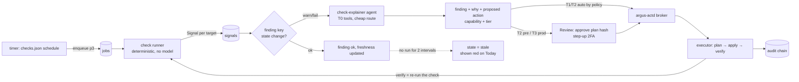
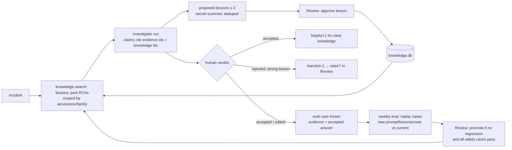

# Argus 2: target architecture

Status: **proposal**, 2026-10-30. Decision record: [ADR-0016](../adr/0016-argus-2-platform.md). Product and IA:
[README.md](README.md). Phases: [roadmap.md](roadmap.md).

What stays from today (load-bearing, not up for redesign): the trust boundaries T0–T8 (OVERVIEW.md §3); the app is a
renderer that never calls an integration and writes only request files (OVERVIEW F6); root dispatchers re-validate
every request; secrets live under `/etc/argus` (→ `/etc/argus` per ADR-0015) and never reach a model or a page;
the secret scanner on everything leaving the host; deploy only via CI (`argus-deploy` → `argus-deploy`); production
read-only unless a human approves the exact change.

## 1. Component map

```
                      ┌─────────────────────────────── one host per company (argus-01 today) ─────────────────────────────┐
 SOURCES (read-only)  │  INGEST (no model)               CORE (Go: one module, two binaries)            STORES          │
 Grafana/Prom/Loki ──────▶ collectors, check runners ──▶ signals ──▶ findings ──▶ problems          ops.db  (argus) │
 Elasticsearch/Splunk │   (Check registry, M2)                        │                             board.db (root)    │
 Sentry ─────────────────▶ alert ingest (Matrix rooms,                ▼                             knowledge.db       │
 GitLab / Jira ──────────▶ alertmanager webhook)            JOB QUEUE (jobs table, priorities)        (argus, FTS5) │
 Matrix/Mattermost/   │   chat ingest (ChatSource)                    │                             /run/argus (tmpfs: │
   Rocket.Chat ──────────▶                                            ▼                              secrets, sessions)│
 Outline/Confluence ─────▶                          AGENT RUNTIME (argus-worker)                                     │
                      │                              router → runtime (claude-code | argus-loop) → Provider          │
                      │                              tool server (argus-tools, MCP stdio): intent tools over        │
                      │                              KnowledgeSource adapters, policy + budgets enforced HERE        │
                      │                                          │ structured result (JSON)                          │
                      │                                          ▼                                                   │
                      │                              record/validate → findings, tasks, proposals, lessons, evals    │
                      │                                                                                              │
                      │  ROOT (root-owned copy of the `argus` binary): dispatchers + ACTION BROKER (argus actd): policy, approvals by plan hash, executors    │
                      │        (ssh-cap, gitlab-api, local, fixer), tracker writers, chat writers, secret box        │
                      │                                                                                              │
                      │  WEB (Go `argus-web`, uid 65534, read-only): view models → html/template pages; /api/v1 JSON      │
                      │        writes request files only (settings-in/<kind>/)                                       │
                      └──────────────────────────────────────────────────────────────────────────────────────────────┘
 AI PROVIDERS: Anthropic (Claude Code OAuth or API key) · OpenAI · Gemini · OpenAI-compatible (Ollama, vLLM, gateways)
```

### 1.1 Code and process layout (Go only, ADR-0016 D1)

No Python at runtime in the target. One Go module (`apps/api`, module path renamed by ADR-0015 P1), two binaries:

| binary | built from | runs as | subcommands / role |
|---|---|---|---|
| `argus-web` (today `argus-web`) | `cmd/argus-web` | uid 65534 in the container | pages + `/api/v1`; **built without writer packages** (import-graph test: `internal/app` may not import `adapters/*/writer`, `internal/actd`, `internal/secrets`) |
| `argus` | `cmd/argus` (multi-call) | argus (from `/opt/argus`), root (root-owned copy in `/usr/local/lib/argus/argus`, never the clone), DynamicUser where today | `worker`, `check run <id>`, `collect <name>`, `watch` (alert/chat ingest), `tools mcp`, `guard` (Claude Code PreToolUse hook), `secret-exec`, `actd`, `dispatch <kind>` (settings-in consumers), `board sync`, `eval`, `config check\|show\|render`, `selfcheck`, `notify`, `ssh-ro <alias> <cmd-id>` |

Packages (under `internal/`): `config`, `store` (ops.db, board.db, knowledge.db; migrations), `domain`,
`adapters/<kind>/<vendor>`, `llm` (`providers/*`, `router`), `agent` (`loop`, `tools`, `claudecode` runtime wrapper),
`worker`, `checks/<family>`, `ingest` (`alerts`, `chat`), `conversations`, `tasks`, `actd` (broker, executors),
`secrets`, `secretscan`, `knowledge`, `learning` (`lessons`, `eval`), `ideas`, `notify`, `sshro`, `app` (today's web
code). External programs Argus still *calls* are not Argus code: `claude` (Claude Code CLI, one runtime option),
`docker`, `git`, `systemd-run`. The OpenSSH client is replaced by `golang.org/x/crypto/ssh` (already vendored).

## 2. Core domain model

Nine entities. Existing tables are **not migrated in a big bang**: each existing domain table keeps its writer and a
projection job upserts the core row (idempotent, keyed), until the writer is moved onto the core table (roadmap).

| entity | meaning | key fields | store / writer | today's equivalents |
|---|---|---|---|---|
| **Source** | a configured adapter instance (one Grafana, one Jira, one Mattermost) | `id`, `kind`, `vendor`, `env_map`, `data_class`, `secret_ref`, `health`, `last_ok_at` | `sources.json` (config) + `source_status` (ops.db) | `OBS_SITES`, Jira/Outline files, `cred-status.json` |
| **Signal** | one raw observation: alert event, check result, chat message, CI event, Sentry issue | `id`, `source_id`, `kind`, `ts`, `subject`, `env`, `payload_ref`, `fingerprint`, `trust=untrusted` | ops.db `signals` (append, 30-day retention, payload in file ref) | `queue/*.json`, `chat_messages`, `cicd_*`, runs TSV |
| **Finding** | a deduplicated, scored assertion about the estate that someone may need to act on | `key` (stable), `family`, `severity`, `env`, `service`, `state` (`ok/warn/fail/stale/unknown/resolved`), `first_seen`, `last_seen`, `evidence[]`, `check_id?`, `problem_id?` | ops.db `findings` | `incidents`, `triage_problems`, `qa_issues`, `cicd_findings`, `cve_findings`, cert/backup rows |
| **Task** | a unit of work, mirrored two-way to a tracker | `id`, `tracker`, `external_key`, `title`, `state`, `assignee`, `env`, `origin` (`chat/finding/idea/human`), `plan_version` | board.db `tasks` (root) | `agent_tasks`, board mirror, GitLab issues |
| **Action** | one capability invocation: plan → approve → execute → verify → rollback | `id`, `capability`, `target`, `env_class`, `params`, `plan_hash`, `tier`, `state`, `executor`, `audit_chain` | board.db `actions`, `action_events` (root, broker) | request files, fixer runs (ACCESS.md §5) |
| **Approval** | a human decision on anything pending (action plan, task proposal, lesson, idea, chat reply, promotion) | `id`, `kind`, `subject_ref`, `subject_hash`, `requested_by`, `decided_by`, `decision`, `reason`, `expires_at` | board.db `approvals` (root) | proposals, idea_events, lessons status, Matrix previews |
| **Run** | one agent execution | `id`, `job_id`, `agent`, `runtime`, `provider`, `model`, `prompt_version`, `knowledge_ids[]`, `cost_usd`, `tokens`, `turns`, `outcome`, `result_ref` | ops.db `runs` (extended) | `runs` |
| **Agent** | a role profile: prompt, tool set, budget, route, allowed tiers | `id` (`triager`, `investigator`, `engineer`, `check-explainer`, `chat-intake`, `ideas-<persona>`, `evaluator`), `prompt`, `tools[]`, `route_class`, `max_tier` | `config/agents.json` (data, shipped defaults) | `prompts/*.md`, `.claude/agents/*`, per-task env caps |
| **Knowledge** | something Argus may retrieve: lesson, accepted RCA, runbook, service note, external doc snippet | `id`, `kind`, `scope` (service/env/family), `status` (`proposed/approved/retired`), `body`, `provenance`, `uses`, `helpful`, `harmful` | knowledge.db (FTS5; optional embeddings) | board.db `lessons`, `service-notes.json`, `rca_reports` |

Supporting: **Check** (definition, data), **Job** (queue row), **Conversation** (a cluster of chat signals with a
thread), **Eval case** (frozen evidence + accepted answer). Relations: Signal →(dedupe)→ Finding →(link)→ Problem;
Finding/Conversation/Idea →(proposal, Approval)→ Task → Runs → Actions (Approvals) → verifying Check → Finding
resolved; Run → proposed Knowledge → Approval → Knowledge → retrieved by later Runs.

## 3. Adapter interfaces

Rules from ADAPTERS.md §1 stand, re-homed in Go (standard library first, `Reader`/`Writer` split, writers only in root, SSRF guard, budgets, audit
line per call, typed errors `AuthError/RateLimited/Unavailable/NotFound/Refused/Disabled`). Package
`apps/api/internal/adapters/<kind>/<vendor>` (Go package per vendor, interface in `<kind>/<kind>.go`); selected by `sources.json`, not by code. A kind that is not configured is a
null adapter: the feature degrades and the UI says "not connected", never errors.

### 3.1 KnowledgeSource (read-only; one adapter can serve several families)

```go
// package adapters/knowledge. Every method takes ctx (deadline = per-call timeout) and returns typed errors
// (ErrAuth, ErrRateLimited, ErrUnavailable, ErrNotFound, ErrRefused, ErrDisabled). A vendor implements the families
// it declares; the others return ErrDisabled.
type Source interface {
    ID() string
    Families() []Family // metrics, logs, errors, traces, code, deploys, docs, tickets
    Health(ctx context.Context) Health
    MetricsQuery(ctx context.Context, q MetricsQuery) ([]Series, error)   // PromQL or native; instant or range
    LogsSearch(ctx context.Context, q LogQuery) ([]LogLine, error)        // since <= 6h, limit <= 500, enforced here
    ErrorsTop(ctx context.Context, service, env string, since time.Time) ([]ErrorGroup, error)
    ErrorDetail(ctx context.Context, ref string) (ErrorDetail, error)     // stack, release, tags
    CodeSearch(ctx context.Context, project, q, ref string) ([]CodeHit, error)
    CodeRead(ctx context.Context, project, path, ref string, lines *Range) (string, error) // <= 64 KB
    DeploysRecent(ctx context.Context, service, env string, since time.Time) ([]Deploy, error)
    DocsSearch(ctx context.Context, q string, limit int) ([]DocHit, error)
    TicketsSearch(ctx context.Context, q string, limit int) ([]TicketHit, error)
}
```

| vendor adapter | families | auth (secret file name) | notes |
|---|---|---|---|
| `grafana_proxy` (exists as `obs.sh`) | metrics, logs | `grafana-<id>-token` (Viewer) | datasource UIDs discovered |
| `prometheus`, `loki` | metrics / logs | optional bearer | direct |
| `elasticsearch` (also OpenSearch) | logs, errors | `es-<id>-apikey` (read role on index patterns) | `_search` with a **query template** (allowlisted fields, `size ≤ 500`, `timeout 20s`), no scripts, no `_delete_by_query`; index patterns in config |
| `splunk` | logs, errors | `splunk-<id>-token` (role with `search` only) | `/services/search/v2/jobs/export`, `earliest_time` ≥ −6h enforced, `max_count`, SPL commands allowlist (no `outputlookup`, `collect`, `sendemail`, `delete`, `script`) |
| `sentry` | errors | `sentry-<id>-token` (`event:read`, `project:read`) | issues, latest event, release |
| `gitlab` (port of `gitlab_ro.py`) | code, deploys, tickets | `gitlab-ro-token` (Reporter, `read_api`) | search, file, MRs, pipelines |
| `github` (later) | code, deploys, tickets | `github-ro-token` | — |
| `outline` (exists), `confluence` (later) | docs | read token | — |
| `jira` (exists) | tickets | PAT read | — |

### 3.2 Tracker (two-way)

```go
type TrackerReader interface {
    Changes(ctx context.Context, since string) ([]IssueEvent, string, error) // created/updated/commented/state-changed
    Get(ctx context.Context, key string) (Issue, error)
}
// TrackerWriter is constructed only from a credential file root can read (NewWriter fails for argus).
type TrackerWriter interface {
    Create(ctx context.Context, d IssueDraft, idemKey string) (IssueRef, error) // idempotent: label argus-src-<hash>
    Comment(ctx context.Context, key, bodyMD, idemKey string) error
    Transition(ctx context.Context, key string, s CanonicalState) error       // todo/in_progress/blocked/review/done
    Link(ctx context.Context, key, url, title string) error
}
```

Adapters `jira` (port of `jira_client.py`, `jira_board.py`), `gitlab_issues` (port of `gitlab_issues.py`). State mapping is
config (`TRACKER_<ID>_STATE_MAP`), never a status name in code. Routing: `TRACKER_ROUTES` (service glob → tracker
id), `TRACKER_DEFAULT`. Conflict rule: the tracker is the source of truth for title/assignee/state; Argus owns its
comments (marker) and its plan. Loops are prevented by the `argus-src-*` label + an echo-suppression window.

### 3.3 ChatSource / ChatWriter

```go
type ChatSource interface {
    Channels(ctx context.Context) ([]Channel, error)
    Messages(ctx context.Context, channelID, since string) ([]ChatMessage, string, error)
}
type ChatMessage struct {
    Platform, ChannelID, MsgID, ThreadID, AuthorID, AuthorDisplay, Text string
    TS time.Time; Attachments []AttachmentRef; Edited bool // Text is untrusted, always
}
type ChatWriter interface { // root only; refuses channels whose reply policy is off
    Post(ctx context.Context, channelID, text, threadID, idemKey string) (MsgRef, error)
    DM(ctx context.Context, userID, text, idemKey string) (MsgRef, error)
}
```

Adapters: `matrix` (port of `matrix.py`/`ops-watch.py`; plain client-server REST to pantalaimon, which does E2EE, until roadmap P11 replaces it with mautrix-go), `mattermost` (REST v4 `GET /channels/{id}/posts?since=`,
bot token, poll 30 s; websocket later), `rocketchat` (REST `channels.history`/`groups.history` with `oldest`, bot
user PAT). Per channel in `channels.json`: `role` (`alerts|qa|team|requests`), `env_hint`, `ingest` (on/off),
`reply` (`off|thread-ack|answers`), `language`, `pre_investigate` (on/off).

### 3.4 AI Provider

```go
type Provider interface {
    ID() string // "anthropic", "openai", "gemini", "ollama-local", ...
    Complete(ctx context.Context, r ModelRequest) (ModelResponse, error)
    State() ProviderState // remaining budget, exhausted_until, last_error (from ops.db provider_state)
}
// ModelRequest{Model, System, Messages, Tools []ToolSchema, MaxTokens, Temperature, ResponseSchema}
// ModelResponse{Content, ToolCalls, Usage{In, Out, Cached}, CostUSD, StopReason}
```

Adapters: `anthropic` (Messages API, API key), `openai_compat` (one adapter for OpenAI, Azure OpenAI, Gemini's
OpenAI-compatible endpoint, Ollama, vLLM, any gateway; `base_url` + key), `gemini` native only if the compat
endpoint lacks a needed feature. Errors normalised: `RateLimited(retry_after)`, `QuotaExhausted(until)`,
`ContextTooLong`, `ContentRefused`, `Unavailable`.

### 3.5 SecretStore

```go
type SecretStore interface { // root only
    Read(name string) ([]byte, error)                                    // names from CONFIG.md §4
    PutEphemeral(task, name string, v []byte, ttl time.Duration) (SecretRef, error) // ADR-0013 §3 semantics
    Wipe(task, reason string) error
}
```

Adapters: `files` (today: `/etc/argus/secrets/<name>` + `LoadCredential=`; ephemeral = tmpfs + per-task key), `vault`
(later, same helper `argus-secret-exec`). No adapter ever returns a value to argus or the app.

## 4. Agent runtime

### 4.1 Job queue

ops.db `jobs(id, kind, agent, priority, payload_json, idem_key UNIQUE, state, attempts, not_before, lease_owner,
lease_until, created_at, finished_at, run_id)`. One long-running `argus worker` (unit `argus-worker.service`, argus, `Restart=always`)
leases jobs (`UPDATE ... WHERE state='queued' AND not_before<=now ORDER BY priority, created_at LIMIT 1`, WAL,
`busy_timeout`), per-class concurrency, leases expire after `timeout + 60 s` so a crashed run is retried once and
then marked `failed`. Timers and `.path` units stop running work directly: they **enqueue** (strangler, unit by
unit). Priority classes:

| class | examples | concurrency | when providers are exhausted |
|---|---|---|---|
| `p1-urgent` | production incident triage, chat issue flagged urgent | 2 | fall back through the whole route, then local model, then notify "unanalysed" with the raw evidence |
| `p2-work` | task intake/run/chat, RCA deep | 1 | fall back through route; else defer ≤ 6 h |
| `p3-routine` | check explanations, log-rca | 1 | defer to next window |
| `p4-background` | ideas, evals, lazy fill | 1 | defer; never uses paid fallback |

### 4.2 Two runtimes, one tool server

- **`claude-code`** (today): `claude -p` via `claude_gate`, unchanged prompts. Kept because it is the strongest
  agentic coder today and the subscription is already paid.
- **`argus-loop`** (new, Go package `internal/agent/loop`): a bounded tool-calling loop over any `Provider`:
  system prompt + retrieved knowledge + task → model → tool calls → `argus-tools` → results (redacted, truncated)
  → ... until a final JSON matching the agent's `response_schema`, or a budget stops it.
- **`argus-tools`** (new, Go package `internal/agent/tools`, subcommand `argus tools mcp`): the one tool catalogue, served as an **MCP stdio server**
  to `claude-code` (and any other MCP-capable CLI) and called in-process by `argus-loop`. Tools are intent-level and
  typed: `metrics.query`, `logs.search`, `errors.top`, `errors.detail`, `code.search`, `code.read`,
  `deploys.recent`, `docs.search`, `tickets.search`, `knowledge.search`, `host.inspect` (wraps the `ssh-ro.sh`
  catalogue), `http.get` (allowlist), `propose.action`, `propose.task`, `propose.lesson`, `ask.human`,
  `request.secret`. **Policy, budgets, redaction and audit are enforced inside the tool server**, so they hold for
  every runtime and every provider; the Claude Code PreToolUse guard stays as a second seatbelt. Read-only agents get
  no `Bash` once their tools exist in the catalogue.
- **Code-aware work** (the engineer agent): a per-run workspace on tmpfs with a shallow clone through the
  read-only token; tests run in `docker run --network none --read-only --memory 2g --cpus 2` with the project's CI
  image; output is a branch `agent/<task>` + MR through the existing `open-mr.sh` path. Writes beyond that are
  Actions.

### 4.3 Provider routing and fallback

`providers.json` lists providers; `config/agents.json` gives each agent a `route_class`; `MODEL_ROUTES` maps a class
to an ordered list:

```
MODEL_ROUTES = {
  "agentic-deep":  ["claude-code:oauth:opus", "claude-code:apikey:sonnet", "argus-loop:openai:<model>", "defer"],
  "agentic":       ["claude-code:oauth:sonnet", "argus-loop:openai:<model>", "argus-loop:gemini:<model>", "defer"],
  "classify":      ["argus-loop:ollama-local:<model>", "argus-loop:anthropic:haiku"],
  "judge":         ["argus-loop:<provider different from the answer's provider>"]
}
```

Router (`internal/llm/router`): skip a provider when `exhausted_until > now`, its daily/weekly USD budget is
spent, or the agent's **data class** is not allowed for it (`PROVIDER_<ID>_DATA_CLASSES`); on `QuotaExhausted` /
Claude CLI "usage limit" exit text, set `exhausted_until` (parsed reset time, else +6 h) in ops.db `provider_state`
and try the next entry within the same job; `defer` re-queues with `not_before`. Every run records provider, model,
cost and whether it was a fallback. A route is only allowed to contain a provider/model whose **eval score** for that
agent is ≥ `MODEL_ROUTE_MIN_SCORE` (§6), so a weaker model cannot silently replace a strong one.

### 4.4 Budgets (all enforced before the call, recorded after)

Per run: USD, turns, tool calls, wall time, output bytes (existing `<TASK>_*` keys become per-agent fields).
Per day per class, per provider per day/week, global `MODEL_DAILY_BUDGET_USD`. Per source adapter: calls/run and
calls/hour (ADAPTERS.md rule 5). Overrun = stop with a partial result recorded, never a silent retry loop.

## 5. Approvals and action safety tiers

The broker (`argus-actd`, ACCESS.md §4–§6, roadmap B1–B4, **not built yet**) is the only path to a write. Tiers:

| tier | what | approval | examples |
|---|---|---|---|
| **T0 read** | any read through a Reader / tool | none (budgets only) | all investigations, checks |
| **T1 self** | writes inside Argus or its own repo | none, audited | re-run a check, snooze own notification, open MR on `agent/*` of Argus repo, draft a proposal |
| **T2 non-prod** | capability on develop; on pre-release | develop: policy may make it automatic; pre-release: one approver | `service.restart` develop, `ci.pipeline.cancel` develop, fixer on dev/pre |
| **T3 prod narrow** | a vetted capability with fixed executor on a production target | **human approves the plan hash**, step-up 2FA, window, one change | `nginx.reload`, `cert.deploy`, `service.restart` on a named group (after the guardrail amendment ACCESS.md §9) |
| **T4 never** | refused in code, whatever the policy says | — | prod DB writes, prod deploy jobs (project 210 class), firewall/DNS, users/keys, Argus's own secrets |

Every row in the UI shows the tier of its next action. Untrusted input (chat, tickets, tool output, alerts) can
create **proposals** only; it can never select a capability or fill a parameter that is not re-derived from
trusted data by root.

## 6. The learning loop

```
run ─▶ structured result (claims + evidence ids + confidence + proposed lessons)
  │
  ├─▶ outcome signals:   human verdict (accepted / edited / rejected + reason) on RCA, plan, answer
  │                      objective: check went green after the action; incident did not recur in 14 d;
  │                      MR merged; problem confirmed; secret-scan or policy violation (negative)
  ├─▶ knowledge:         proposed lessons → Review → approved → knowledge.db (scope, provenance)
  └─▶ eval cases:        an accepted RCA/plan becomes a frozen case: evidence bundle (redacted) + accepted answer
```

- **Retrieval**: at run start the runtime queries knowledge.db (FTS5 BM25 over approved lessons, accepted RCAs,
  runbooks, service notes, synced external docs; scope boost for service/env/family; optional embedding rerank when
  `KNOWLEDGE_EMBEDDINGS=on`), capped by `LESSONS_PROMPT_MAX` / `_BYTES` (ADR-0013). The run records which items it
  saw; a cited item gets `helpful+1` when the run is accepted, `harmful+1` when rejected with "wrong lesson".
- **Evaluation**: `argus eval` (`internal/learning/eval`) replays the eval set (weekly, p4 class, own budget `EVAL_WEEKLY_BUDGET_USD`)
  for a candidate configuration (prompt version, knowledge snapshot, model route) and scores each case:
  deterministic checks (valid schema, cites ≥ 1 evidence id, every host/service named exists in inventory, no secret,
  stays in tier) + an LLM judge from a **different provider** comparing the root cause and fix with the accepted
  answer (rubric 0–4) + cost and latency. Safety cases (prompt injection in chat text, production write bait) must
  all pass.
- **Promotion**: a new prompt version, a model route change or a batch of lessons is a **Knowledge change** in
  Review showing old vs new scores; it is promotable only if the mean score does not drop by more than
  `EVAL_MAX_REGRESSION` (0.1) and no safety case fails. An admin promotes. Rollback = re-select the previous version
  (versions are immutable rows).
- **Metrics** (Argus → Quality): RCA acceptance rate, edit rate, time to first useful answer, recurrence within 14 d,
  cost per accepted answer, check false-positive rate, proposal acceptance rate, eval score per agent × model over
  time, lesson helpfulness. These are the definition of "smarter".

## 7. Multi-company configuration

One install per company (ADR-0016 D9). Configuration = `argus.env` (scalars; CONFIG.md, keys renamed `ARGUS_*` by
ADR-0015 P1 with aliases) + JSON data files in `ARGUS_CONFIG_DIR` (default `/etc/argus/config`), all validated by
`argus config check` (`internal/config`, one loader for every binary) against `config/schema/*.json` (hand-written Go validator, no schema library); the self-check runs it and the
services refuse to start on a required key missing, with the key name in the message.

| file | holds | required | reader |
|---|---|---|---|
| `argus.env` | company name, public URL, TZ, locale, feature toggles, budgets | yes | `internal/config` |
| `environments.json` | environment classes, host/IP ranges, unknown = production (ADR-0006) | yes | guard, fixer, broker, ssh-ro |
| `sources.json` | `[{id, kind, vendor, url, families, env_map, data_class, secret, limits}]` | at least one monitoring source | adapters, tool server |
| `trackers.json` | `[{id, vendor, url, project, state_map, labels}]`, `routes`, `default` | no (Work degrades to local tasks) | board sync, tracker adapters |
| `channels.json` | `[{id, platform, channel, role, env_hint, ingest, reply, pre_investigate, language}]` | no | chat ingest, ChatWriter |
| `providers.json` | `[{id, adapter, base_url, secret, models[], data_classes, daily_usd, weekly_usd}]`, `routes` | yes (≥ 1) | router |
| `checks.json` | `[{id, family, kind, targets, schedule, thresholds, source, owner, runbook, actions[{capability, tier}]}]` | no (shipped defaults per family) | check runner |
| `agents.json` | agent profiles (shipped defaults; override per key) | no | runtime |
| `policy.json` | broker policy (ACCESS.md §4) | yes when `ACTIONS_MODE≠off` | `argus-actd` |

Secrets are referenced by name only (`"secret": "splunk-main-token"` → `/etc/argus/secrets/splunk-main-token`).
Onboarding: Settings → Sources/Trackers/Chat/AI providers render the config with a **Test** button per entry; a
connect form writes the secret through `settings-in/<kind>-connect/` (existing root path) and never shows it again.

New `argus.env` keys introduced by Argus 2 (all optional, safe defaults; full table goes to CONFIG.md in the phase
that ships them):

| key | type | default | validation | reader |
|---|---|---|---|---|
| `ARGUS_NAV_V2` | bool | `0` (P1), `1` after | — | `apps/api/internal/app/layout.go` |
| `ARGUS_WORKER_CONCURRENCY` | json map class→int | `{"p1-urgent":2,"p2-work":1,"p3-routine":1,"p4-background":1}` | 0..4 | `internal/worker` (`argus worker`) |
| `MODEL_ROUTES` | json (in `providers.json`) | Claude-only routes = today | provider ids exist | `internal/llm/router` |
| `MODEL_ROUTE_MIN_SCORE` | float | `2.5` | 0..4 | router |
| `PROVIDER_EXHAUSTED_DEFAULT_H` | int | `6` | 1..168 | router |
| `CHAT_PREINVESTIGATE_DAILY_USD` | float | `3` | 0..100 | `internal/conversations` |
| `KNOWLEDGE_EMBEDDINGS` | on/off | `off` | — | `internal/knowledge` |
| `EVAL_WEEKLY_BUDGET_USD`, `EVAL_MAX_REGRESSION` | float | `5`, `0.1` | 0..50, 0..1 | `internal/learning/eval` |
| `TASK_SECRETS_REQUIRE_TLS_HOP` | bool | `1` | — | `internal/app` secret route, `internal/secrets` |

## 8. Data stores

| store | owner | contents | why |
|---|---|---|---|
| `ops.db` (SQLite WAL) | argus | signals, findings, runs, jobs, provider_state, source_status, eval results, existing tables | evidence and agent state; non-root writers |
| `board.db` (SQLite) | root | tasks, approvals, actions, action_events, secrets metadata, lessons (until moved) | decisions and writes must be root-owned (T1) |
| `knowledge.db` (SQLite FTS5 via `modernc.org/sqlite`, pure Go, already vendored) | argus writes **approved** items only via root-signed export | knowledge items, usage, embeddings (blob) | retrieval separated from evidence; rebuildable from board.db + files |
| files | — | evidence bundles, RCA markdown, eval cases (`/var/lib/argus/evidence/<id>.json.zst`), state JSON | large payloads out of SQLite |
| tmpfs `/run/argus` | root | ephemeral secrets, per-task model config dirs | crypto-shred on wipe or reboot |

Rejected: PostgreSQL (operations cost for one host; revisit only if a company needs HA), a vector database (a few
thousand items: FTS5 + brute-force cosine is enough), Redis/RabbitMQ for the queue (SQLite lease table is enough at
tens of jobs per hour).

## 9. Key flows

### 9.1 Day-2 check → action



### 9.2 Chat message → issue → agent work

```mermaid
flowchart LR
  C[Mattermost / Rocket.Chat / Matrix] -->|ChatSource poll| SG[(signals: untrusted)]
  SG --> CL[chat-intake agent<br/>classify + cluster, local/cheap model]
  CL -->|noise| N[ignored, counted]
  CL -->|issue raised| CV[Conversation + Finding]
  CV -->|pre_investigate=on, budget left| INV[investigator agent<br/>T0 tools only: logs, errors, code, deploys]
  INV --> DR[draft task: summary, evidence, RCA, plan]
  DR --> RV[Review: Accept & create issue]
  RV -->|human accepts| TW[TrackerWriter create<br/>Jira or GitLab by TRACKER_ROUTES]
  TW --> TK[Task in Work, In Progress]
  TK -->|Start: plan hash approved| RUN[engineer agent<br/>branch + MR, actions via broker]
  RUN -->|needs credential| SB[request.secret → secret box<br/>TLS hop, step-up, tmpfs, TTL]
  RUN --> CW[ChatWriter: thread reply<br/>only if channel reply=answers, after preview OK]
```



New-task chat (Work → New task) is the same flow entered at `CV` by a signed-in human: the draft is shown in the
chat, and **Create issue** in the chat is the human acceptance.

### 9.3 RCA → lesson → better next RCA



## 10. Security changes Argus 2 needs

1. **Secret box hop (ADR-0013 open item):** the Go app serves the backend listener with TLS
   (`ARGUS_BACKEND_TLS_CERT`, `ARGUS_BACKEND_TLS_KEY`, internal CA), the edges proxy with `proxy_ssl_verify on` and
   the pinned CA, edge log format has no body variables; the app refuses `POST /board/task/secret` unless it arrived
   on the TLS listener from a trusted proxy (`TASK_SECRETS_REQUIRE_TLS_HOP=1`). Then `TASK_SECRETS=on` for develop and
   pre-release tasks only (release stays refused, ADR-0013 D3). Rejected: client-side encryption (needs JavaScript),
   secrets over Matrix DM (persists in room history and server).
2. **External providers see only `data_class`-allowed evidence**, after the secret scanner (`internal/secretscan`, port of `secret_scan.py`); raw chat text from
   customer-facing channels defaults to local/internal providers only.
3. **Chat ingestion is untrusted end to end**: intake and investigator agents have T0 tools only, egress limited to
   configured sources, a daily budget; their output can only become a proposal.
4. **Tool server owns policy**: every tool call is checked against the agent's tool list, the environment class of
   its target and the run budget, and logged (method, target template, status, ms; never bodies).
